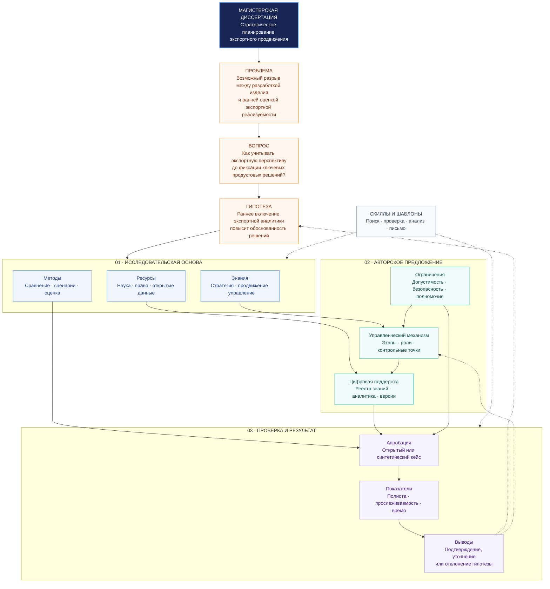

# Карта знаний

Рабочая логика исследования. Стрелки обозначают исследовательские связи, а не доказанную причинность. Пунктир — обратную связь при проверке.

## Переходы по карте

| Узел | Материалы | Ожидаемый результат |
|---|---|---|
| Проблема и гипотеза | [Паспорт](01_research/README.md) | Проверяемые вопросы |
| Исследовательская основа | [Знания](02_knowledge/README.md), [ресурсы](04_resources/README.md) | Подтверждённые положения |
| Методы | [Методология](05_methods/README.md) | Воспроизводимый протокол |
| Механизм | [Проект решения](06_proposed-solution/README.md) | Авторская модель |
| Проверка | [Апробация](07_validation/README.md) | Результаты и ограничения |
| Инструменты | [Скиллы](03_skills/README.md), [шаблоны](09_templates/README.md) | Единый порядок работы |
